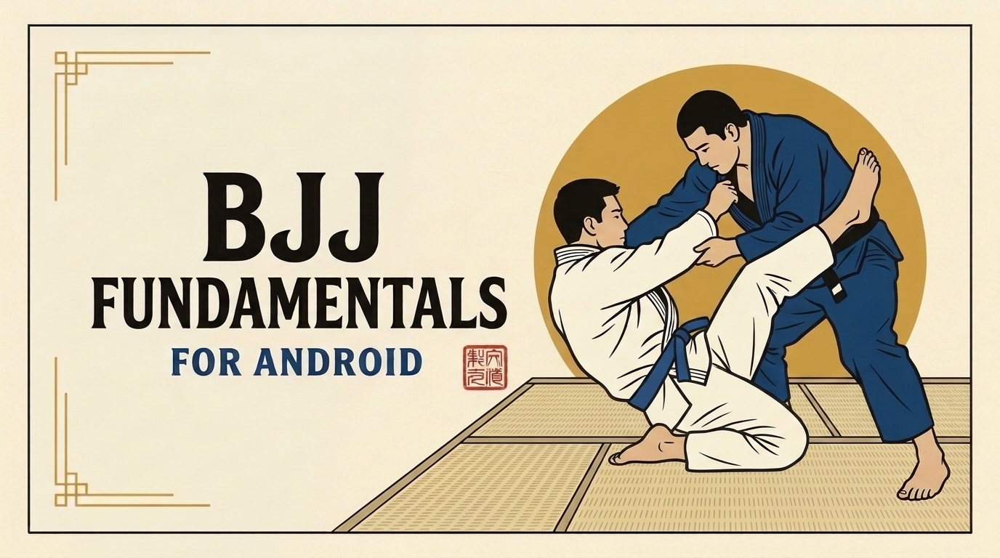
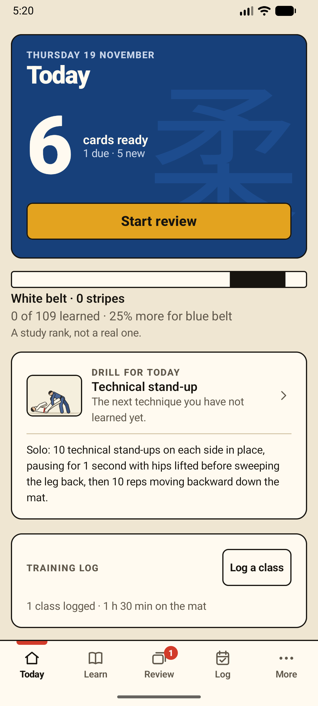
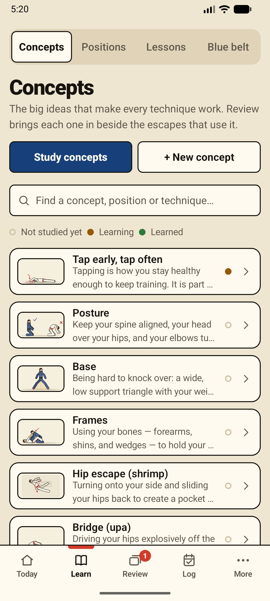
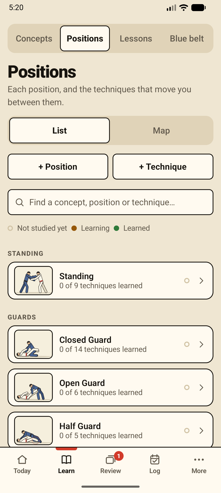
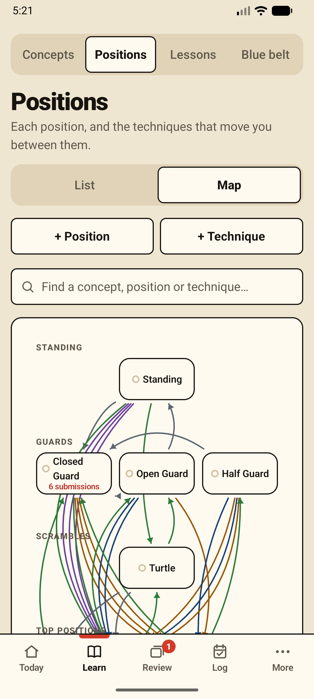
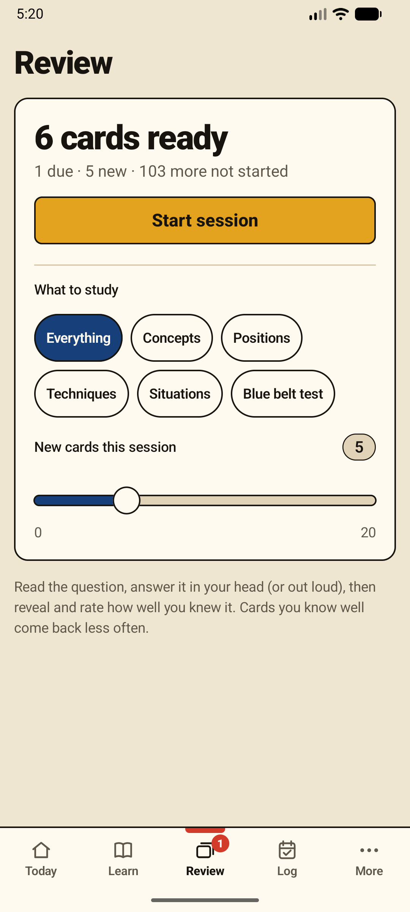
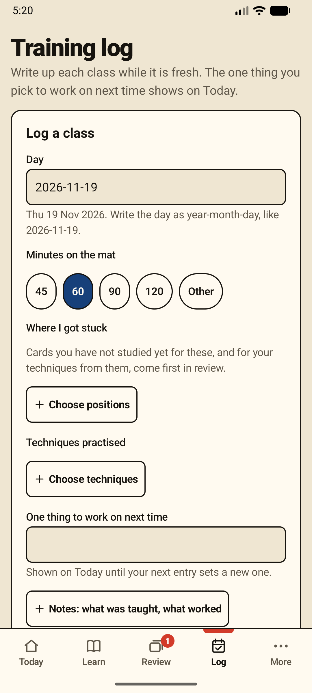

<p align="center">
  
</p>

# BJJ Fundamentals for Android

The native Android version of **BJJ Fundamentals**: beginner Brazilian Jiu-Jitsu concepts, positions, and the techniques that connect them, learned with spaced repetition. Everything stays on the device.

- **Offline-first, no accounts, no backend.** All data lives in a local Room database on the device. The only network call is YouTube's player (`youtube-nocookie.com`) on a study item that has a bookmarked video.
- **Concepts** – tap early, posture, base, frames, shrimping, bridging, underhooks, grips, pressure, and more, each illustrated with custom figure diagrams.
- **Position map & technique chains** – core positions (standing, guards, scrambles, top positions) and the sweeps, passes, escapes, takedowns, and submissions that move between them.
- **Spaced-repetition review** – every concept, position, technique, and situation is a flashcard (simplified SM-2) with deck filters and adjustable new-card limits.
- **Training log** – record mat time, positions where you got stuck (which are prioritised in review), techniques practised, and one focus for next class.
- **YouTube timestamp bookmarks** – attach timestamped links to any item; concept, position, and technique videos play inline on their page and review card.
- **Shared JSON backup** – export and import the exact same JSON backup file as the web app in a single transaction.
- **Woodblock print aesthetic & adaptive layout** – flat ink-outlined cards on warm tatami paper (light and dark themes), adapting from phone bottom bar to foldable/tablet navigation rail and two-column layouts.

## Screenshots

| Today | Concepts | Positions |
| :---: | :---: | :---: |
|  |  |  |

| Position Map | Review | Training Log |
| :---: | :---: | :---: |
|  |  |  |

## Build & check

This project uses the **Kotlin Toolchain (Amper)** through the `./kotlin` wrapper (not Gradle):

```sh
./kotlin build -m androidApp     # build the Android app
./kotlin test -m core -p jvm     # run core unit tests on JVM
./kotlin check lint detekt       # run ktlint and detekt
./kotlin do format               # apply ktlint auto-fixes
tools/check.sh                   # run every check CI runs
```

To install and run on the `amper-37` emulator, see [`.claude/skills/run-on-device`](.claude/skills/run-on-device/SKILL.md).

## Architecture

Imports only point inward: `ui → bindings → storage → core`. **`libs/core` is the app; everything else is a replaceable shell around it.**

| Module | Role |
| --- | --- |
| `libs/core` | Pure Kotlin models, spaced repetition, queue building, map layout, figure geometry, starter content, `AppStorage` interface, and services |
| `libs/core-testing` | Shared storage contract tests and entity builders |
| `libs/storage-room` | Room implementation of `AppStorage` |
| `libs/design` | Woodblock theme, tokens, components, icons, and figure drawings |
| `apps/app` | Koin DI, `Snapshot` bindings, Navigation 3 routes, and Compose screens |
| `apps/androidApp` | Android manifest, resources, `MainActivity`, and application class |

See [AGENTS.md](AGENTS.md), [docs/architecture.md](docs/architecture.md), [docs/parity.md](docs/parity.md), and [docs/testing.md](docs/testing.md) for full details.
